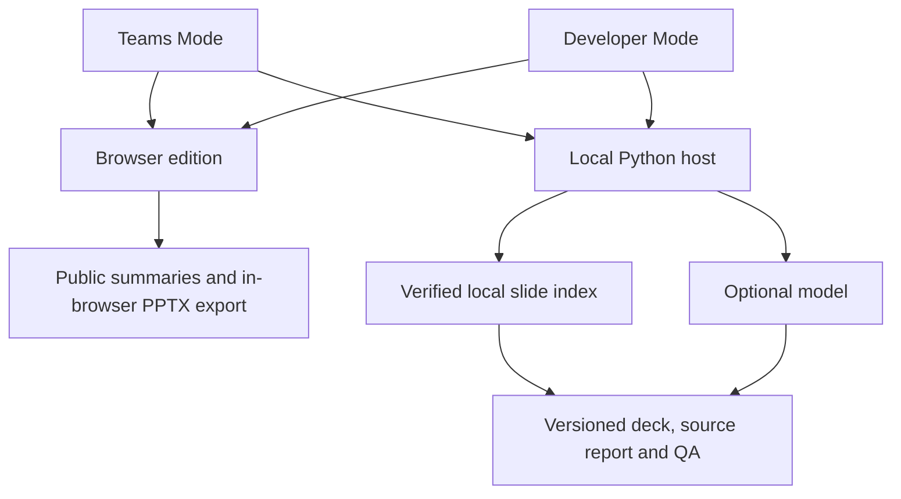

# Developer guide

## Architecture and component inventory



| Component | Path from repository root | Responsibility |
|---|---|---|
| Teams / Developer views | `studio/index.html` and `studio/studio.html` | Chat, outline, downloads and developer inspection |
| Browser edition | `studio/browser-engine.js`, `studio/evidence.json` and `studio/vendor/` | Public page summaries, browser-only work and local generation of downloadable files |
| Local HTTP host | `scripts/serve_studio.py` | Role access, session cookies, output ownership, model budget and tunnel lifecycle |
| Retrieval and session logic | `presentation_search/brief_index.py` and `presentation_search/studio_service.py` | Validate settings, rank source pages, explain choices, maintain outline and revisions |
| Export and optional model | `presentation_search/studio_export.py` and `presentation_search/studio_model.py` | Assemble native/rebuilt slides, write notes, source/QA reports and model-adapted text |
| Catalogue and configuration | `examples/public_corpus/amr/catalog.csv`, `scripts/prepare_amr_corpus.py` and `scripts/build_studio_config.py` | Check publisher files, prepare the local collection and rebuild the Studio component inventory |
| Microsoft pilot | `presentation_search/main.py` and `integrations/copilot-studio/` | Entra-authenticated connector API, Swagger, prompts and topic blueprint for the maker |

**Request lifecycle.** The interface loads session status, posts a chat turn and displays the returned candidate outline. Export writes a version of the outline, including a source mapping and QA checks. Downloads are resolved against the current session. The browser edition handles the corresponding user actions in the browser; it holds only its curated public records. Developer Mode reads a component inventory and local role-gated statistics.

## Operating and extending the service

1. **Run it.** Use the launchers in the installation guide. For backend work, install testing dependencies into the project venv with `python -m pip install -e ".[test]"`. Start explicitly with `python scripts/serve_studio.py --corpus PATH` from the repository root after activating that environment.
2. **Change the behaviour.** Extend local schema validation and service behaviour before wiring a new setting into the UI. Update the browser implementation separately if it can implement the same behaviour from public data. Document any edition-specific difference. Regenerate the inventory after changes to prompts, tools or configuration with `python scripts/build_studio_config.py`.
3. **Refresh the corpus.** Use `python scripts/prepare_amr_corpus.py --refresh`. Check the verified manifest, counts and failures. A hash mismatch requires review of the new publisher file before changing the catalogue. Curated summaries have their own evidence and page mapping.
4. **Verify.** Run `python -m pytest` from the repository root. Rehearse the three export modes against a known deck. Verify notes, original page/URL, regeneration after a template change and access from two sessions. For browser-edition changes repeat export and open the PPTX in desktop PowerPoint. Use the release evaluation report for checks actually run.
5. **Keep runtimes separate.** The local HTTP demo exposes session-scoped JSON routes. The organizational connector calls the production FastAPI operations and uses Entra and Graph. Follow the migration guide when adding a tenant feature.

### Inspect the local API during a rehearsal

| Operation | Request | Expected behaviour |
|---|---|---|
| Identify the active edition and role | `GET /api/session` | Returns role, authentication status and model availability. |
| Update and inspect a brief | `POST /api/chat`, `GET /api/history` | Returns session-scoped outline, warnings and version history. |
| Create and retrieve a version | `POST /api/export`, then the returned file URL | Allows only session-owned files returned by the exporter. |
| Inspect the host | `GET /api/developer` | Developer role required. Monitor totals can be compared with the local budget ledger. |

## Security, governance and limits

| Scope | Implemented boundary | Operational implication |
|---|---|---|
| Local and tunnel access | Host-generated or supplied role passwords, session cookies, login/request limits and developer-only live data | Share visitor credentials only with pilot participants. Download results before signing out or stopping the host. |
| Files | A per-session output workspace and version-bound downloads. Runtime data stays outside tracked source. | A session’s links are temporary. Save approved outputs to the agreed destination and apply its retention policy. |
| Optional hosted model | Requires explicit server enablement, a project key and an eligible role. OpenAI calls reserve a shared request/token allowance in the local SQLite ledger before network access. | Excerpts and requests may reach the selected provider. Failed requests can consume local reservations. Measure actual billed use at the provider. |
| Public browser edition | A bounded catalogue of public paraphrases, public component descriptions and local browser exports | Use local or organizational deployment for restricted decks. Browser downloads must be saved by the participant. |
| Organizational pilot | Entra user identity for API access, service-side source index and separately scoped Graph grants | Test source-group membership, per-job ownership and SharePoint destination permissions separately. |

**Known limitations.** Source layout and object compatibility can trigger reconstruction. Existing picture text and native chart labels follow the original language. Local structural QA can flag layout risks but cannot establish scientific accuracy, the right to redistribute third-party assets, or final PowerPoint rendering. Original-deck availability changes as publishers update files. The Teams channel, organization permissions, model charges and tenant licensing require verification in the chosen deployment.

**Roadmap.** First, use the pilot prompts and a content-owner review to measure source relevance, translation and layout quality on representative topics. Next, complete an authenticated Dev/Test pilot with isolated output and a measured cost per completed deck. Extend access after CSI signs off the release, telemetry and rollback path. If the audience expands beyond a shared source-access group, implement permission-filtered indexing or separate authorized collections and validate with users with different source access.

### Reproduce the local model comparison

Start Ollama locally and install the model tags under test. These commands run the same two-slide Zambia outreach brief through the offline engine and two local models. The report includes per-page evidence, generated notes, provenance checks, elapsed time and token counts reported by Ollama.

```bash
ollama pull qwen3:4b
ollama pull qwen3:0.6b
python scripts/prepare_studio_sample.py
python scripts/compare_studio_models.py --corpus .local/studio-sample --model qwen3:4b --model qwen3:0.6b --output .local/model-comparison.json
```

The measured release run is available in [model-comparison.json](model-comparison.json).
